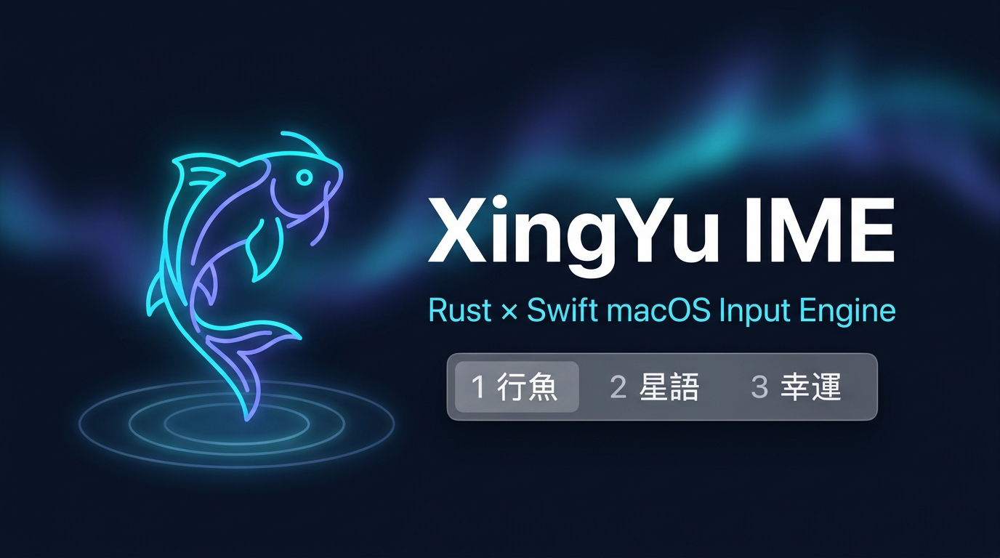
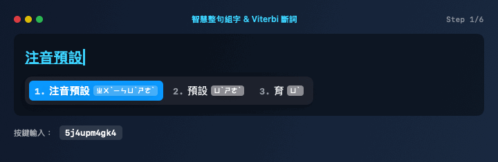
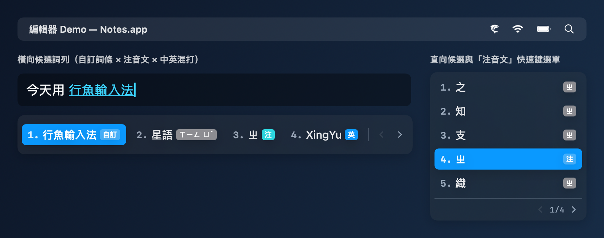
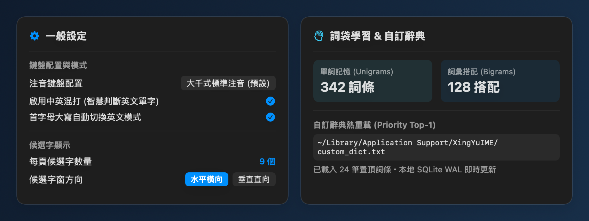
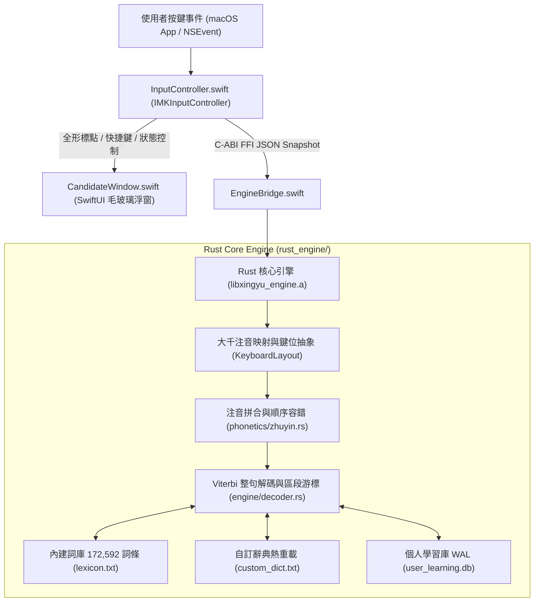

# 行魚輸入法 (XingYu IME)

**「行如流水，如魚得水」— 專為 macOS 打造的 Rust × Swift 高效能智慧繁體注音與中英混打輸入法**

<div align="center">



<br />
<br />


[](https://www.apple.com/macos/)
[](https://www.rust-lang.org/)
[](https://swift.org/)
[](#七-開發與測試-development--testing)
[](LICENSE)

*An intelligent, low-latency Traditional Chinese (Bopomofo / Zhuyin) & seamless English mixed-typing Input Method Editor for macOS, powered by a Rust Lattice-Viterbi engine and a native Swift InputMethodKit UI.*

</div>

---

## 效果展示與介面預覽 (Demo & Screenshots)

### 即時組字、重選、注音文直出與中英混打動畫

<p align="center">
  
</p>

### 候選字詞列（橫向／直向 × 自訂／注音／英文標籤）與偏好設定

<p align="center">
  
</p>

<p align="center">
  
</p>

---

## 一、 核心特色 (Features)

- **連續整句組字與 Viterbi 智慧斷詞**
  - 內建 **172,592 筆**繁體中文注音詞庫（`rust_engine/data/lexicon.txt`，融合 [McBopomofo](https://github.com/openvanilla/McBopomofo) MIT 開源詞庫與詞頻權重），涵蓋常用單字、二字詞、三字詞與四字成語片語。
  - 透過 **Lattice + Viterbi 動態規劃解碼器**（`Lazy<Arc<PrefixTrie>>` 單例共享載入），支援長句連續不間斷輸入，邊打邊動態修正最佳上下文切詞。
- **句中區段游標、多頁選字與點擊操作**
  - 打完長句後可使用 `←` / `→` 移動至句子中的任一詞彙區段原地更換候選詞，且即使縮短多音節詞（例如將「第一」改選為「地」），仍會自動保留後續音節繼續編輯。
  - 透過數字鍵、滑鼠點擊或選字空白鍵選取最後一字後，會自動收合候選視窗並保持底線組字狀態（可隨時按 `←` / `→` / `↓` 再次重選或繼續輸入）；按 `Return (Enter)` 則直接確認並送出整句（無需多按一次 Enter）。
  - 支援**台灣注音文直出 (`[注]`)**：單一注音符號（如 `ㄅ`、`ㄏ`、`ㄓ`、`ㄧ`、`ㄚ`）保底出現在第 1 頁候選列，完整音節（如 `ㄓㄨˋ`、`ㄏㄠˇ`）亦可直接選取純注音符號表達語意。
  - 支援**候選詞分頁瀏覽**（每頁 `5~9` 字可調，最多 200 筆同音字詞）：透過 `↑` / `↓` / `Tab`、`PageUp` / `PageDown`（`Fn + ↑/↓`）、選字模式 `[` / `]` 或滑鼠點擊 `‹` / `›` 自由翻頁，突破單頁 9 字限制。
  - 支援偏好設定中的**水平橫向 / 垂直直向**候選視窗切換，並精準跟隨當前編輯區段游標位置顯示。
- **順序容錯拼合與長句錯字隔離 (Out-of-Order & Typo Isolation)**
  - 高速打字時若不小心將單一音節內的聲母、介音或韻母順序微微打顛倒，引擎會自動進行音韻合法性正規化容錯，減少卡字重打的挫折。
  - 輸入長句時若後段不慎打錯注音或誤觸按鍵，僅該錯字區段會保持原按鍵，不會讓前面已組出的中文字句整段退回英文。
- **無縫中英混打與大寫英文優先**
  - **英文連續輸入**：可直接連續輸入多個英文單字並透過空白鍵分隔，不必反覆切換輸入法或被多餘的 Enter 打斷。
  - **Shift 大寫即時切換**：輸入 `Shift + 字母` 時立即進入英文優先模式；若正在組中文句中按下大寫字母，會自動確認先前中文並無縫開啟新英文緩衝區。
  - **一聲自動成字**：位於未標調中文音節尾端時，空白鍵自動作為「一聲（陰平）」完成音節並繼續輸入下一字。
- **SQLite WAL 自適應學習與自訂辭典熱重載**
  - 本地 `SQLite`（WAL 模式）持續記錄個人用詞頻率（Unigram）與詞彙二元搭配（Bigram），越打越貼近個人習慣。
  - 支援純文字自訂辭典（`custom_dict.txt`），修改存檔後自動 **Hot-Reload 熱重載**，自訂詞條無條件強制置頂於第一候選。
- **macOS 原生毛玻璃 UI 與選單列適配**
  - 採用 `SwiftUI` + `AppKit`（InputMethodKit）打造跟隨游標的毛玻璃懸浮候選視窗與原生 Template 選單列飛魚圖示，並內建四分頁「偏好設定」介面（`Command + ,`）。

---

## 二、 系統架構 (Architecture)



---

## 三、 快速安裝與啟用 (Installation)

### 方式一：透過 Homebrew 安裝（推薦，免自行編譯）

支援 macOS 13.0 (Ventura) 以上之 Apple Silicon 與 Intel Mac：

```bash
brew install --cask ADT109119/tap/xingyu-ime
```

> [!NOTE]
> 若使用 Homebrew 7.x 以上版本首次安裝第三方 Tap 時出現 untrusted tap 提示，請先執行 `brew trust ADT109119/tap` 再安裝。

升級版本：

```bash
brew upgrade --cask xingyu-ime
```

### 方式二：從 GitHub Releases 下載預編譯檔

1. 前往 [Releases 頁面](https://github.com/ADT109119/XingYu-IME/releases) 下載最新的 `XingYuIME-*-universal.zip` 並解壓縮得到 `XingYuIME.app`。
2. 因專案採用 Ad-hoc 簽章，請在終端機複製至輸入法目錄並清除隔離標記：

```bash
mkdir -p "$HOME/Library/Input Methods"
killall XingYuIME 2>/dev/null || true
rm -rf "$HOME/Library/Input Methods/XingYuIME.app"
cp -R ~/Downloads/XingYuIME.app "$HOME/Library/Input Methods/XingYuIME.app"
xattr -cr "$HOME/Library/Input Methods/XingYuIME.app"
killall TextInputMenuAgent TextInputSwitcher 2>/dev/null || true
```

### 方式三：從原始碼一鍵編譯與安裝

#### 系統需求

- **macOS 13.0 (Ventura)** 或更新版本
- **Rust Toolchain** (`rustc`、`cargo`)
- **Xcode Command Line Tools** (`swiftc`、`codesign`)
- **Python 3**（供安裝腳本寫入 `com.apple.HIToolbox.plist` 啟用紀錄）

```bash
git clone https://github.com/ADT109119/XingYu-IME.git
cd XingYu-IME

# 編譯 Rust 靜態庫與 Swift .app，並自動安裝至 ~/Library/Input Methods/
chmod +x scripts/build.sh scripts/install.sh
./scripts/install.sh
```

> [!TIP]
> 若系統設定選單尚未立即出現新輸入法，請於安裝後執行以下步驟：
> 1. 打開 **系統設定 (System Settings)** → **鍵盤 (Keyboard)** → **文字輸入「編輯」**。
> 2. 點擊左下角 `+`，於 **繁體中文** 清單中選擇 **「行魚輸入法」** 並加入。
> 3. 若系統剛完成首次 `TISRegisterInputSource` 註冊，建議重新登入 macOS 或重新啟動一次該應用程式。

---

## 四、 操作說明與快捷鍵 (Shortcuts)

### 輸入與選詞控制

| 按鍵 | 功能說明 |
| :--- | :--- |
| **大千式注音按鍵** | 連續輸入注音符號（如 `s`=ㄋ、`u`=ㄧ、`3`=ˇ），支援音節內順序微調容錯 |
| **英文字母** | 支援中英混合輸入與英文詞彙候選 |
| **Shift + 英文字母** | 輸入大寫英文並立即切換為英文優先模式；若正組中文則先確認中文再接續英文 |
| **Space (空白鍵)** | 於未標調中文音節尾端作為「一聲（陰平）」；選字模式下套用目前高亮候選詞；一般組字狀態下送出緩衝並支援英文空白接續 |
| **← / → 方向鍵** | 於句中切換要重選的詞彙區段，或在候選清單中左右切換 |
| **↑ / ↓ / Tab** | 進入選字模式並跨頁上／下或循環切換目前區段的候選詞，即時於組字區預覽 |
| **PageUp / PageDown (`Fn + ↑/↓`)** | 快速切換上／下一頁候選詞（選字模式下亦可按 `[` / `]` 或點擊 `‹` / `›` 翻頁） |
| **數字鍵 1 ~ 9** | 選字／游標重選狀態下按主鍵盤 `1~9`，或隨時按 **數字小鍵盤 / `Shift + 1~9`** 於句內套用當前頁對應編號候選詞 |
| **Return (Enter)** | 確認並送出整句組字結果（含數字鍵盤 Enter；選完最後一字直接送出並關閉選字窗，不會多跳一次；若於句中先選較短前段詞，會推進至剩餘音節繼續編輯） |
| **Backspace** | 刪除最後一個輸入鍵位或還原重組；緩衝區為空時放行給系統刪除已輸入文字 |
| **Escape** | 退出選字／游標重選模式，或清空尚未送出的組字緩衝區 |
| **Command + ,** | 隨時開啟「行魚輸入法偏好設定」視窗 |

### 全形標點符號快捷鍵

| 按鍵組合 | 輸出符號 | 按鍵組合 | 輸出符號 |
| :--- | :---: | :--- | :---: |
| `Shift + ,` / `Ctrl + ,` | `，` | `Shift + .` / `Ctrl + .` | `。` |
| `Shift + /` / `Ctrl + /` | `？` | `Shift + ;` / `Ctrl + ;` | `：` |
| `Shift + 1` / `Ctrl + 1` | `！` | `Ctrl + '` / `\` / `` ` `` | `、` |
| `[` / `]` | `「` / `」` | `Shift + [` / `Shift + ]` | `『` / `』` |
| `'` / `Shift + '` | `’` / `”` | `Shift + \` / `Shift + ` `` | `｜` / `～` |
| `Shift + 9` / `Shift + 0` | `（` / `）` | `Shift + -` / `Shift + 6` | `——` / `……` |
| `=` / `Shift + =` | `＝` / `＋` | `Shift + 2 / 3 / 4 / 5 / 8` | `＠` `＃` `＄` `％` `＊` |

---

## 五、 自訂辭典與個人資料路徑

行魚輸入法將個人化設定與學習資料保存於：

- **自訂辭典**：`~/Library/Application Support/XingYuIME/custom_dict.txt`
- **學習資料庫**：`~/Library/Application Support/XingYuIME/user_learning.db`

自訂辭典格式為 Tab 或空白分隔（第三欄權重為選填）：

```text
# 格式：詞條 [Tab] 注音或英文字串 [Tab] 權重(選填)
行魚輸入法	ㄒㄧㄥˊ ㄩˊ ㄕㄨ ㄖㄨˋ ㄈㄚˇ	5000
人工智慧	ㄖㄣˊ ㄍㄨㄥ ㄓˋ ㄏㄨㄟˋ	3000
XingYuIME	XingYuIME	5000
```

您也可以直接透過 `Command + ,` 開啟偏好設定視窗，在「**自訂辭典**」分頁中一鍵新增詞條、開啟編輯或觸發即時重載，並在「**詞袋學習**」分頁查看目前的 Unigram / Bigram 記憶統計與進行重設。

---

## 六、 專案目錄結構 (Project Structure)

```text
IME/
├── assets/                     # Logo (logo.png)、Banner、示範動畫 (demo_typing.gif) 與截圖
├── rust_engine/                # Rust 核心推論引擎 (staticlib + C-ABI)
│   ├── Cargo.toml
│   ├── data/lexicon.txt        # 172,592 筆繁體注音基礎詞庫
│   └── src/
│       ├── lib.rs              # 核心 Engine 狀態機與單元測試
│       ├── engine/             # Viterbi 解碼器 (decoder.rs) 與 SQLite 學習庫 (user_db.rs)
│       ├── ffi/                # Swift C-ABI 橋接層 (c_api.rs)
│       ├── keyboard/           # KeyboardLayout trait 與大千/倚天/拼音鍵盤配置
│       ├── lexicon/            # Trie 前綴詞庫檢索與 CustomDictionary 熱重載
│       └── phonetics/          # 注音音韻拼合與順序容錯
├── swift_frontend/             # macOS Swift + IMK 原生前端
│   ├── Resources/              # Info.plist、AppIcon.icns、XingYuTemplate.tiff (選單列 Template 圖示) 與 *.lproj
│   └── Sources/                # InputController、CandidateWindow、SettingsView 等
├── scripts/
│   ├── build.sh                # 建置 Release 版並打包簽章 build/XingYuIME.app（支援 --universal）
│   ├── install.sh              # 安裝至 ~/Library/Input Methods 並註冊 TIS 輸入來源
│   └── package.sh              # 打包 Universal Binary .zip 與 SHA-256 校驗檔
├── packaging/
│   └── homebrew/Casks/xingyu-ime.rb  # Homebrew Tap Cask 範本
├── .github/workflows/
│   └── release.yml             # 推送 v* tag 自動建置並發布 GitHub Release
├── CONTRIBUTING.md             # 開發與貢獻指南
├── LICENSE                     # MIT License
└── .gitignore
```

---

## 七、 開發與測試 (Development & Testing)

詳細架構導覽與貢獻流程請參閱 [CONTRIBUTING.md](CONTRIBUTING.md)。

```bash
# 執行 Rust 核心引擎單元測試（15 項整合與演算法測試）
cargo test --manifest-path rust_engine/Cargo.toml

# 僅編譯並打包 .app 至 ./build/XingYuIME.app
./scripts/build.sh
```

---

## 八、 授權協議與致謝 (License & Acknowledgments)

- 本專案採用 [MIT License](LICENSE) 授權條款。
- 內建繁體中文注音詞庫包含來自 [openvanilla/McBopomofo](https://github.com/openvanilla/McBopomofo)（MIT License）的字音與詞頻資料，特此致謝。
